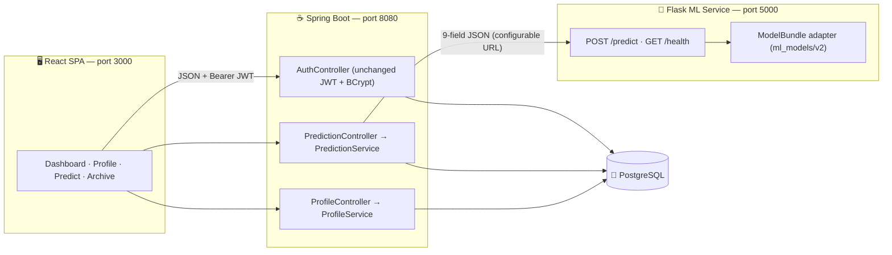

<div align="center">

# 🎓 EDU2JOB 2.0

### Discover Your Career Fit

*Top-5 job-role recommendations for technical **and** non-technical students,
from a nine-feature profile — React → Spring Boot → Flask ML service.*


</div>

---

## 📖 What changed in 2.0

EDU2JOB 2.0 replaces the original 4-input, 7-role model with a new model
trained on `edu2job_dataset.csv` (10,000 students × 9 input features,
target `top_5_job_roles` across 128 job roles, MultiOutput Random Forest,
538 features after preprocessing). The whole stack — React form, Spring
DTOs/entities, Flask inference — now speaks one nine-field contract.

**Honest status:** the application migration is complete, but the NEW
trained artifacts have **not been supplied yet**, so genuine inference is
intentionally disabled: the Flask service reports `modelReady: false` and
returns `503` rather than falling back to the old model or inventing
predictions. See [Model artifact installation](#-model-artifact-installation)
for exactly which files to drop in (the empty `ml_models/v2/` folder is
waiting for them).

| | 1.x (old) | 2.0 |
|---|---|---|
| Inputs | degree, major, cgpa, skills, `yop` | **degree, major, cgpa, skills, certification_name, internship_experience, projects_count, communication_skill, experience_months** |
| Audience | Mostly CS/engineering | Technical **and** non-technical students |
| Output | Top-5 of 7 roles, calibrated % | Up to 5 ranked roles of 128; score only when the model truly provides one |
| Flask URL | Hardcoded `localhost:5000` | `FLASK_BASE_URL` config + timeouts |
| History | Raw JSON blob | Nine inputs + ranked roles + `modelVersion`; legacy rows preserved and labelled |

---

## 🏗️ Architecture



Design principles (unchanged where they worked, tightened where they didn't):

- **Single entry point** — React talks only to Spring Boot; the browser never reaches Flask or the database.
- **Python for ML, Java for business logic** — no cross-language model translation.
- **No silent fallbacks** — if the new model isn't installed, prediction returns a clear `503`. The old model is never loaded by 2.0 code.
- **Auditable predictions** — every prediction row stores the nine inputs, the raw model response, and the model version.
- **Scores are never fabricated** — rank-only model output is returned with `score: null` and the UI shows "no confidence score provided".

### One prediction, end to end

1. React validates the nine fields and POSTs to `POST /api/predict/` with the JWT.
2. Spring Boot resolves the user from the token, re-validates (Bean Validation), and forwards exactly the nine snake_case fields to Flask.
3. Flask validates again, builds the raw 9-column frame, runs it through the fitted preprocessor (if separate) and the MultiOutput forest, and decodes a ranked top-5 (see artifact README for decode modes).
4. Spring persists inputs + raw output + `modelVersion`, then returns `{predictionId, modelVersion, predictions}`.
5. React renders ranked cards; Archive analytics aggregate only real persisted rows.

---

## 🧾 The nine-field schema (single source of truth)

| # | Field (JSON) | Java DTO | Type | Rules |
|---|---|---|---|---|
| 1 | `degree` | `degree` | string | Required; broad degree list (B.Tech…MBA, Other) until dataset vocabularies land |
| 2 | `major` | `major` | string | Required; technical + non-technical majors |
| 3 | `cgpa` | `cgpa` | BigDecimal / number | Required, 0–10 (10-point scale, never a percentage) |
| 4 | `skills` | `skills` | string[] | Required, ≥1; add/remove chips in the UI; stored as a JSON array |
| 5 | `certification_name` | `certificationName` | string \| null | Optional; empty/`None` ⇒ `null` (never invented) |
| 6 | `internship_experience` | `internshipExperience` | string | Required; `Yes`/`No` (exact training representation wins once metadata lands) |
| 7 | `projects_count` | `projectsCount` | integer | Required, ≥ 0 |
| 8 | `communication_skill` | `communicationSkill` | string | Required; Beginner / Intermediate / Advanced (provisional) |
| 9 | `experience_months` | `experienceMonths` | integer | Required, ≥ 0; months of relevant experience |

Target: `top_5_job_roles` (up to five ranked job roles).

---

## 🔌 API Reference

### Spring Boot (`http://localhost:8080`)

| Method | Endpoint | Auth | Description |
|---|---|---|---|
| `POST` | `/api/auth/register` | — | Create account → returns JWT (unchanged) |
| `POST` | `/api/auth/login` | — | Authenticate → returns JWT (unchanged) |
| `POST` | `/api/profile/update` | JWT | Create/update profile; partial updates preserve omitted fields |
| `GET` | `/api/profile/latest` | JWT | Latest profile (nine fields) |
| `POST` | `/api/predict/` | JWT | Run prediction → ranked top-5 (also archived) |
| `GET` | `/api/predict/history` | JWT | This user's history (legacy rows have `modelVersion: null`) |

**Prediction request** (exactly what Flask receives):

```json
{
  "degree": "B.Tech",
  "major": "Computer Science",
  "cgpa": 8.5,
  "skills": ["Python", "SQL", "Java"],
  "certification_name": null,
  "internship_experience": "Yes",
  "projects_count": 3,
  "communication_skill": "Advanced",
  "experience_months": 6
}
```

**Prediction response:**

```json
{
  "predictionId": 101,
  "modelVersion": "edu2job-v2",
  "predictions": [
    { "rank": 1, "role": "Data Analyst", "score": null }
  ]
}
```

Error bodies: `400 {message, errors}` for validation · `401 {message}` for
auth · `503 {message}` when the ML model is not ready · `502 {message}` for
invalid ML responses. No stack traces or internals are exposed.

### Flask ML service (`http://localhost:5000`, internal — Spring-only)

| Method | Endpoint | Description |
|---|---|---|
| `GET` | `/health` | `200` + `modelReady: true` only when the new model is loaded; otherwise `503` with `missingArtifacts` and a human-readable `detail` |
| `POST` | `/predict` | Nine-field schema → `{modelVersion, predictions[{rank, role, score, scope?}]}`; `400` validation / `503` not ready / `502` undecodable output |

`scope` is static editorial career text from `job_scopes.py` — explicitly
not model output.

---

## 🗄️ Database migration

Existing data is preserved. The migration:

- **Adds only nullable columns** — `certification_name`, `internship_experience`, `projects_count`, `communication_skill`, `experience_months` to both `user_prediction_history` and `pred_history`, plus `model_version` on `pred_history`.
- **Keeps** `year_of_graduation` for legacy rows (no longer written), keeps `cgpa` as `numeric(4,2)`, keeps `skills` as TEXT (new rows store a JSON array; legacy comma-joined values still parse).
- **Never touches** `users` — accounts, IDs, and BCrypt hashes are unchanged, so existing logins keep working.
- Runs automatically via Hibernate (`ddl-auto=update`, which only adds), or manually with `EDU2JOB/src/main/resources/db/migration/V2__edu2job_2_profile_and_prediction.sql`. No Flyway was introduced (the project had no migration history to build on).
- Old predictions keep `model_version = NULL` → the API/UI label them **"Legacy (previous model)"** and never reinterpret them.

---

## 🚀 Getting Started

Prerequisites: JDK 21+, Maven 3.8+, Python 3.11+, Node 18+, PostgreSQL (local or cloud, e.g. Neon).

### 0️⃣ Configure environment

```bash
cp .env.example .env   # then fill in real values; never commit .env
```

Key variables: `DATABASE_URL` (use `jdbc:postgresql://…`), `DATABASE_USERNAME`,
`DATABASE_PASSWORD`, `JWT_SECRET` (≥32 random chars), `FLASK_BASE_URL`,
`MODEL_DIR`. **Rotate any credentials that were previously committed to this
repo** (older revisions contained database credentials in
`application.properties`).

### 1️⃣ Flask ML service (port 5000)

```bash
cd edu2job-flask-ai
python -m venv venv && source venv/bin/activate   # Windows: venv\Scripts\activate
pip install -r requirements.txt
python app.py
curl http://localhost:5000/health   # 503 + modelReady:false until artifacts land — that's correct
```

### 2️⃣ Spring Boot backend (port 8080)

```bash
cd EDU2JOB
mvn spring-boot:run
```

### 3️⃣ React frontend (port 3000)

```bash
cd edu2job-react-frontend
npm install
npm start
```

Open **http://localhost:3000**, register, complete the nine-field profile,
and (once artifacts are installed) run a prediction.

---

## 📦 Model artifact installation

Full instructions live in **`edu2job-flask-ai/ml_models/README.md`**.
Short version — drop these into the (currently empty) `ml_models/v2/`:

| File | Why |
|---|---|
| `model.pkl` | The fitted MultiOutput Random Forest (or a full Pipeline) |
| `preprocessor.pkl` | Fitted 9 → 538 feature pipeline (unless inside `model.pkl`) |
| `job_role_labels.json` | The 128 role names in training output order |
| `model_metadata.json` | `decode_mode` (`single_label`/`multi_label`/`rank_positions`), category vocabularies, training versions |

Verify with `GET /health` (`modelReady: true`, `labelsLoaded: 128`), then
the sample `curl` in the artifact README. Do **not** copy the old
`ml_models/*.pkl` files into `v2/` — they are the retired 7-role model.

Form option lists (degrees, majors, skills, certifications, communication
levels) are currently broad provisional lists in
`edu2job-react-frontend/src/constants/profileOptions.js`; finalize them
against `edu2job_dataset.csv` and mirror the same vocabularies into
`model_metadata.json`, after which Flask rejects unsupported values with a
clear 400.

---

## 🧪 Testing

```bash
# Flask (adapter tests with fake estimators — not real inference)
cd edu2job-flask-ai && pip install -r requirements-dev.txt && pytest

# React (validation, payload contract, results rendering)
cd edu2job-react-frontend && CI=true npm test -- --watchAll=false

# Spring Boot (profile service, prediction flow with mocked Flask, DTO validation)
cd EDU2JOB && mvn test
```

Migration-time results (2026-10-14 sandbox): **Flask 9 passed · React 9
passed · React production build compiles**. Spring tests were authored but
**not executed** in the migration sandbox (no JDK/Maven available there) —
run `mvn test` on a JDK 21 machine to confirm.

---

## 🔐 Security Notes

- **Passwords** — BCrypt (unchanged); never stored/logged in plain text, never returned in responses.
- **Tokens** — JWT HS256, 10-hour expiry, verified on every protected call; the signing secret is now injected via `JWT_SECRET` (existing accounts unaffected; changing the secret only forces re-login).
- **Ownership** — profile and history are always resolved from the JWT subject; request bodies carry no user ID, so one user cannot read another's data.
- **CORS** — still restricted to the React dev origin (unchanged, not weakened).
- **Secrets** — no credentials in the React bundle or repo config; database credentials that appeared in older committed config must be rotated.

---

## 🧭 Known limitations & roadmap

- ⏳ **New model artifacts pending** — the single blocker for genuine inference (files listed above). Predictions honestly return `503` until then.
- ⏳ **Dataset vocabularies pending** — `edu2job_dataset.csv` was not in the workspace; form options + Flask vocabularies must be finalized from it.
- [ ] **JWT filter** — token checks still live in the controller layer (centralized in `AuthUserResolver`); a `OncePerRequestFilter` + tightening `SecurityConfig` permit rules remains future work.
- [ ] **Resilience** — Spring→Flask now has timeouts; retries/circuit-breaker still to add.
- [ ] Role-based access control; profile change snapshots for richer analytics.

No model accuracy, calibration, or evaluation figures are claimed for the
new model — none were supplied, and none will be invented here.
